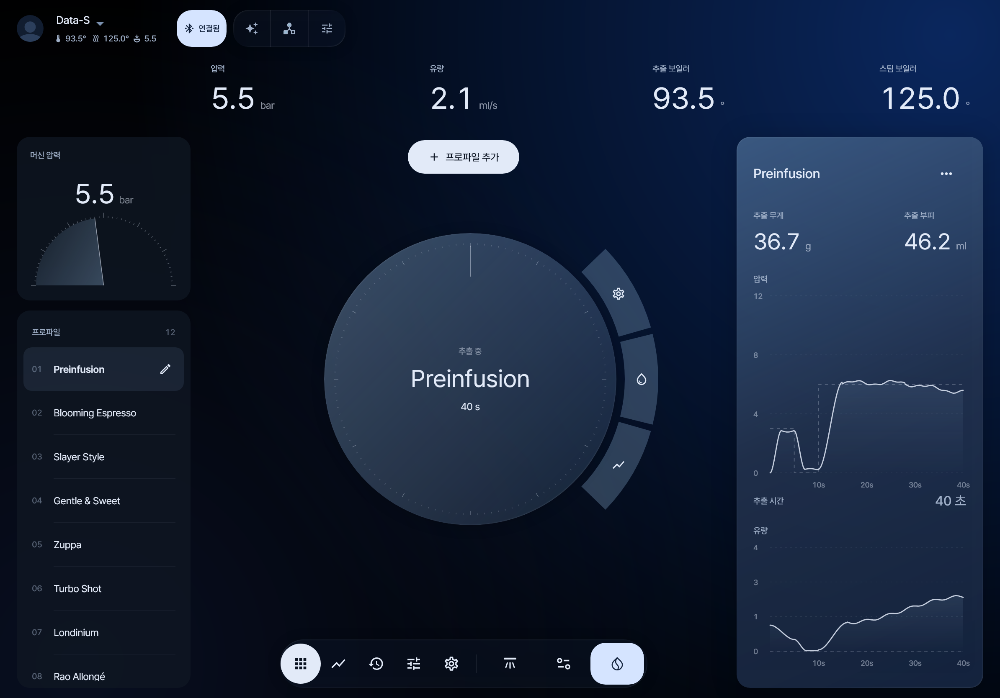
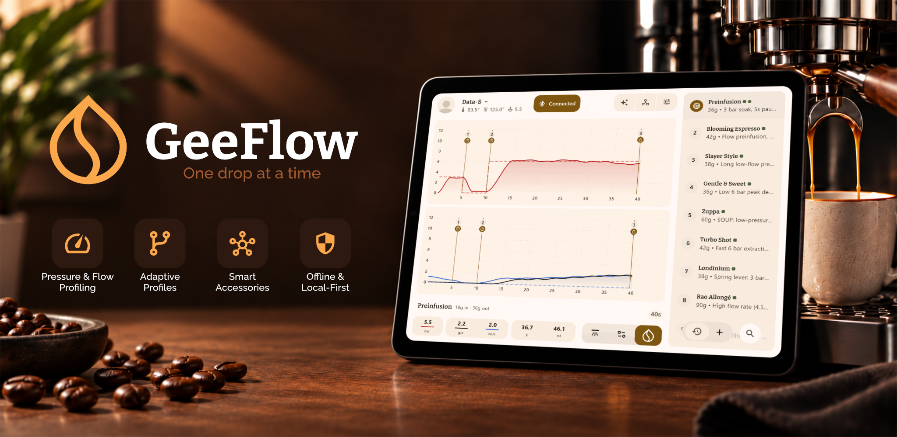

# PR-Wendougee · GeeFlow iPad UI

GeeFlow 기반의 개인용 Wendougee LITA UI 작업입니다. Pretendard, 한국어, 가로 iPad 배치와 시간 연동 테마를 적용합니다.

낮에는 흰색과 붉은 주황빛, 밤에는 검정과 짙은 파랑으로 배경이 바뀝니다. 그래프는 테두리 없는 콘텐츠 표면으로, 레시피 사이드바와 조작부는 블러·굴절을 적용한 유리 재질로 구분합니다. 측정값은 그래프 창 왼쪽 끝에 맞춘 도트 숫자와 하단 기준선에 정렬한 단위로 표시합니다.

| 낮 | 밤 |
| --- | --- |
|  |  |

위 이미지는 실제 공유 Compose 화면을 1194×834 논리 해상도로 렌더링한 결과입니다. 머신 연결과 추출값은 데모 데이터이며, 기존 레시피 이름과 설명은 사용자 데이터로 취급합니다. 메뉴·편집기·설정·오류 안내는 한국어를 지원합니다.

[1024×768 낮](docs/review/tablet-1024.png) · [1024×768 밤](docs/review/tablet-1024-night.png) · [좁은 화면 배치](docs/review/phone-1.png)

Mac에서 캡처부터 보려면 Node.js로 `node scripts/preview-compose.cjs docs/review`를 실행하고 `http://127.0.0.1:4181`을 엽니다. 앱 실행은 아래 Mac 안내를 참고하세요.

- 앱 기반: [drobekk/GeeFlow](https://github.com/drobekk/GeeFlow), upstream `085f9ee621b7ba241543b63778272b241a6ece74`
- [Mac 실행 안내](docs/MAC_HANDOFF.md) · [UI 변경 내용](docs/UI-CHANGES.md)
- [앱 빌드와 UI 검증](https://github.com/iismn/PR-Wendougee/actions/workflows/ipad-design.yml)
- GeeFlow 원본의 GPL-3.0 라이선스와 이력을 유지합니다. 아래 다운로드 링크와 원본 설명은 upstream 프로젝트에 관한 것입니다.

---

  

# GeeFlow

A Kotlin Multiplatform app for controlling and monitoring espresso machines over BLE, targeting **Android**, **iOS**, and **Desktop (JVM)**.

  
  &nbsp;&nbsp;
  

  <a href="https://github.com/drobekk/GeeFlow/releases/latest">Download for Windows and macOS</a>

## Screenshots

### Tablet

  
  
  

### Phone

  
  
  

## Supported Hardware

- **Wendougee Data-S**
- **Wendougee LITA**

A built-in **Demo** device is available for preview purposes. It simulates a machine entirely in software, so you can explore the whole app (dashboard, profiles, charts, history) without owning any hardware. Add it from the *Add Device* screen.

> [!WARNING]
> **This is an unofficial, third-party application.** While it utilizes the manufacturer's native communication protocol, the integration was independently reverse-engineered and is not endorsed, certified, or supported by the manufacturer.
>
> Because this application sends direct hardware commands (including heating targets, pressure profiles, and cleaning cycles), unforeseen bugs or firmware incompatibilities could cause your machine to operate incorrectly.
>
> **By using this software, you acknowledge and agree that:**
> - You use it entirely at your own risk.
> - It may cause unintended behavior, damage your machine, or void your warranty.
> - You must **never** leave the machine unattended while it is under app control.

### Machine Errors

GeeFlow displays machine errors in a dedicated dialog, with descriptions for known errors and numeric codes for unknown ones. Active errors block brewing and cleaning; stop commands and boiler settings remain available.

## Features

**Brewing**
- Manual brewing with configurable time and pressure
- Per-machine paddle settings: treat manual brews as flushes (no history or chart) and Auto flush after brewing with a configurable delay; Auto flush requires the app to stay active and connected
- Profile brewing with multi-step pressure, flow, and wait stages (variable-pressure and constant-pressure modes)
- Experimental profiles with app-controlled ramps and measurement-based step transitions
- Freehand ("free variable") brewing - steer pressure or flow live from a control screen, and optionally save the result as a profile
- Finish conditions by target weight or target volume
- Stop a brew at any time

**Brew Profiles**
- Create, edit, duplicate, delete, and reorder profiles
- Visual profile editor with per-step editing and descriptions
- Profiles are per-user; a set of defaults ships with the app and can be restored
- Bind compatible profiles to the machine's paddle/button for native execution; once bound, edits are synced to the machine as you save them, and a failed sync aborts the save
- Save profiles even when they exceed the machine's native recording capacity or use features that cannot be bound to its paddle/button

**Experimental Profiles**
- GeeFlow runs these profiles by sending live targets and evaluating measurements throughout the brew, rather than uploading the complete profile for the machine to execute
- Use pressure or flow steps with wait steps, each with a required time limit. Combining pressure and flow in an experimental profile requires a machine that supports live control mode switching
- Choose instant, linear, ease-in, ease-out, or ease-in-out transitions for pressure and flow targets, with a configurable ramp duration
- Start a ramp from the previous target or the current measurement
- Add exit conditions for total volume, total weight, pressure, and flow; pressure and flow support upper and lower thresholds
- Use OR to advance when any measurement condition is met, or AND to require all measurement conditions to be met at the same time. The time limit always ends the step independently of AND/OR
- Weight-based conditions require a connected scale
- Experimental indicators identify features that the selected machine cannot execute natively. Available features depend on the machine's capabilities
- Experimental profiles require the app to remain active and connected during brewing and cannot be assigned to the machine's paddle/button

On the Wendougee Data-S, experimental profiles use the machine's native freehand pressure or flow control. GeeFlow sends target updates for ramps and evaluates exit conditions, while the machine regulates pressure or flow internally. Since switching the active control mode during freehand brewing is not supported, an experimental profile must use one control mode throughout, with optional wait steps. Native profiles can still combine pressure and flow steps. Reported pressure is pump pressure, not puck backpressure.

**Live Monitoring**
- Real-time dashboard: brew and steam boiler temperatures, pressure, flow rate, volume, weight, weight rate, and elapsed time
- Live charts for pressure, flow rate, weight rate, volume, and weight, each of which can be hidden or shown at will
- Pressure, pump flow, and weight rate share a chart, with weight rate hidden by default
- Profile charts show target ramps, numbered step boundaries, and exit-condition markers, including the conditions that triggered transitions during brewing
- Brew history with the recorded curve and the profile steps as they were at brew time

**Machine Control & Settings**
- Brew and steam boiler targets, with independent on/off per boiler
- Full-speed and pulse heating modes
- Manual brew time and pressure defaults
- Separate Daily Cleaning and Deep Cleaning programs with configurable flush duration, rest duration, and cycle count, plus start/stop and live cleaning status. Deep Cleaning is intended for use with cleaning detergent
- Water alarm toggle
- Separate machine error dialog with descriptions for known codes and numeric values for unknown codes
- Quick settings and quick maintenance dialogs on the dashboard; long-press the quick settings button to toggle the steam boiler without opening anything

**Maintenance Reminders**
- Optional reminders for Daily Cleaning and Deep Cleaning, with independent intervals of 1-365 days, saved per machine
- Due or overdue reminders appear on the machine's dashboard when the app is active and the machine is connected, idle, and reports no error, including after reconnecting or resuming the app
- Reminders use local calendar dates, with no scheduled time or system notifications
- Open Quick Maintenance from a reminder to select and start the suggested cleaning program, or choose Skip to move its next reminder forward by the configured interval
- Closing the reminder with X or Back leaves its due date unchanged; it appears again when returning to the dashboard, resuming the app, or reconnecting the machine
- Pressing Start counts as cleaning for reminder purposes, even if the program later fails or is stopped. A start rejected because of an active machine error does not reschedule reminders. Daily Cleaning reschedules its own reminder; Deep Cleaning reschedules both
- When both reminders are due, a single reminder suggests Deep Cleaning, which also covers Daily Cleaning. Skipping it reschedules both reminders

**Smart Scale**
- Scan for, connect, and disconnect a supported Bluetooth scale
- Live weight and flow-by-weight feed into the dashboard, charts, and weight-based finish conditions

**Devices**
- Pair via QR code or by scanning for nearby BLE devices
- Multiple saved devices, with a favorite and optional auto-connect
- Connection state surfaced throughout (connecting, synchronizing, connected)

**Adaptive Layout**
- Works in both portrait and landscape, on phones, tablets, and desktop windows
- Layouts adapt to the available width rather than the platform: settings screens switch to a list-detail arrangement when there is room, and the dashboard, profile editor, and pairing flow reflow to match
- Resizing a desktop window or rotating a device re-lays out live, without losing state

**Users & Personalization**
- Multiple local user profiles, each with its own photo, brew profiles, history, and settings
- Theming: light/dark/system, custom seed color, palette style
- Celsius/Fahrenheit
- Keep-screen-on, full-screen mode
- Open-source license listing

---

Learn more about [Kotlin Multiplatform](https://www.jetbrains.com/help/kotlin-multiplatform-dev/get-started.html) and
[Compose Multiplatform](https://github.com/JetBrains/compose-multiplatform/#compose-multiplatform).

## License

This project is licensed under the GNU General Public License v3.0 - see the [LICENSE](./LICENSE) file for details.
