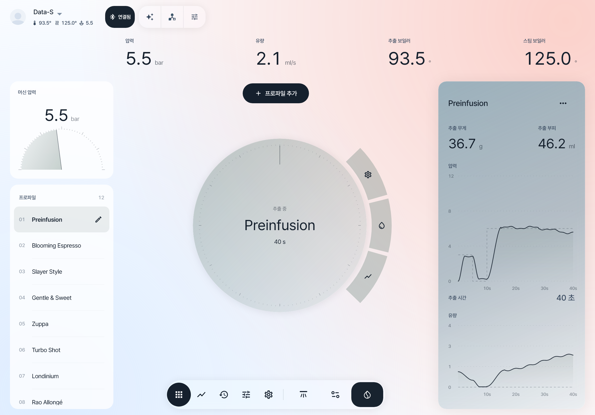
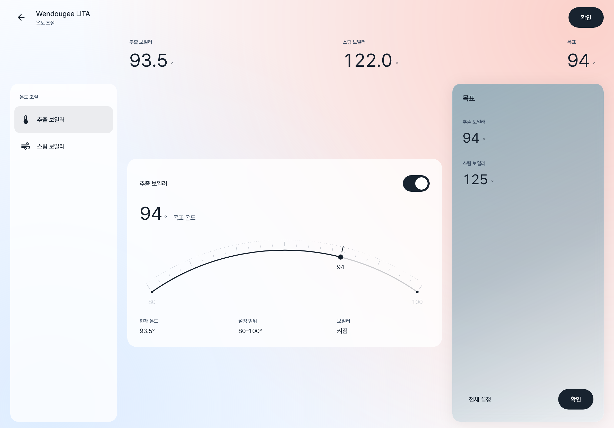
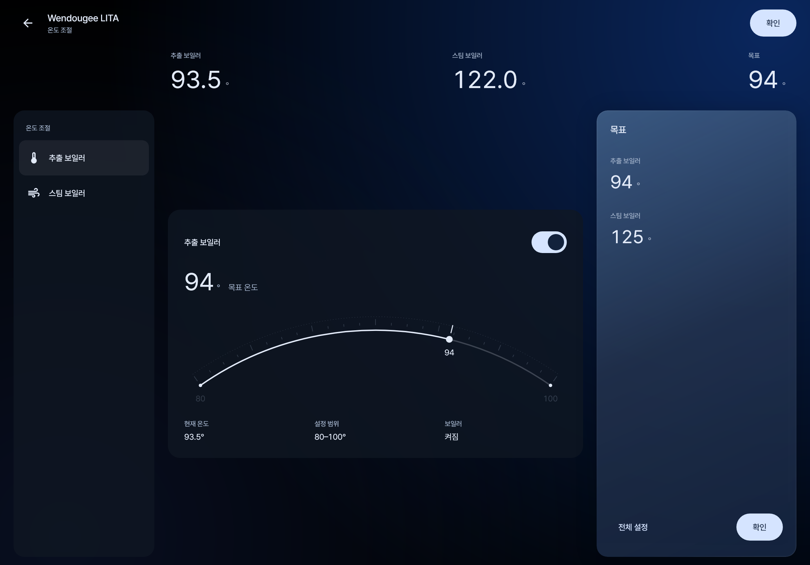

<div align="center">

# Wendougee LITA

Wendougee LITA · iPad Landscape · 한국어 / English



<br><br>

**커피머신 옆에 놓는, 가로 iPad를 위한 Wendougee LITA.**

[Mac에서 실행하기](docs/MAC_HANDOFF.md) · [UI 변경 내용](docs/UI-CHANGES.md) · [전체 화면 목록](docs/UI-CATALOG.md) · [빌드 상태](https://github.com/iismn/PR-Wendougee/actions/workflows/ipad-design.yml) · [Issues](https://github.com/iismn/PR-Wendougee/issues)

[프로파일](#프로파일) · [온도 조절](#온도-조절) · [낮과 밤](#낮과-밤) · [GeeFlow](#geeflow)

</div>

<br>

## 프로파일

왼쪽의 정돈된 목록에서 레시피를 선택하고, 중앙의 큰 원에서 현재 프로파일과 추출 진행을 확인합니다. 오른쪽에는 압력·유량 그래프와 추출량을 함께 표시합니다.

중앙 원을 누르면 프로파일을 편집합니다. 원 옆의 세 아이콘은 온도 설정, 자유 제어, 상세 그래프로 이어집니다. 가운데 아래에는 메뉴와 추출 조작부를 하나의 바에 모았습니다.

<sub>이미지는 실제 공유 Compose 화면을 JVM에서 렌더링한 결과입니다. 표시된 연결 상태와 측정값은 GeeFlow 데모 데이터이며 UIKit Liquid Glass 캡처는 아닙니다.</sub>

<br>

## 온도 조절



홈과 같은 왼쪽 목록·중앙 조절기·오른쪽 요약 패널을 사용합니다. 왼쪽에서 추출 보일러와 스팀 보일러를 선택합니다. 곡선 눈금을 드래그하거나 탭해서 목표 온도를 바꾸고, 큰 숫자를 누르면 직접 입력할 수 있습니다. 현재 온도, 조절 범위, 켜짐 상태를 각 카드 아래에 표시합니다.

온도는 머신이 제공하는 값에 맞춰 조절되며, 기존 확인 동작을 거쳐 적용됩니다.

<br>

## 낮과 밤

| 낮 | 밤 |
| :---: | :---: |
|  |  |
|  |  |

낮에는 흰색과 붉은 주황빛, 밤에는 검정과 짙은 파랑. **화면 → 화면 모드 → 시간에 맞춰 자동**에서 현지 시간에 따라 배경이 바뀝니다. 앱 색상을 조절하며 디스플레이의 하드웨어 밝기는 바꾸지 않습니다.

Pretendard와 한국어를 기본 UI 전반에 적용했습니다. 도트로 그리던 숫자와 글자는 제거하고 일반 글꼴로 통일했습니다. 프로파일 이름과 직접 작성한 설명은 그대로 유지합니다.

iPadOS 26 이상에서는 `UIVisualEffectView`의 **`UIGlassEffect`**를 사용합니다. 투명한 Compose 화면 뒤에 UIKit 배경과 네이티브 유리 계층을 배치합니다. 이전 iPadOS에서는 `UIBlurEffect`로 대체됩니다. Windows·Android 미리보기는 별도의 공유 렌더러를 사용합니다.

<br>

<details>
<summary><strong>Mac에서 로컬 빌드</strong></summary>

Xcode 26 이상과 JDK 21이 필요합니다. 설치한 Xcode에 맞는 macOS 요구 사항은 [Apple 안내](https://developer.apple.com/xcode/system-requirements/)를 확인하세요. Android SDK 설정을 포함한 전체 절차는 [Mac 실행 안내](docs/MAC_HANDOFF.md)에 있습니다.

```sh
git clone https://github.com/iismn/PR-Wendougee.git
cd PR-Wendougee
open iosApp/iosApp.xcodeproj
```

Xcode에서 **iosApp → iPad Simulator → Run**을 선택합니다. 실제 iPad 설치에는 본인의 Signing Team이 필요합니다. 이 포크의 별도 App Store 앱이나 설치용 IPA는 아직 배포하지 않았습니다.

Windows에서는 iOS/Xcode 빌드를 실행할 수 없습니다. UI 배치와 한국어는 로컬 Compose 렌더로 빠르게 확인하고, 네이티브 유리는 Mac의 iPad 시뮬레이터 또는 실제 iPad에서 확인합니다. Mac에서는 같은 작업 폴더와 빌드 캐시를 유지해 반복 빌드 시간을 줄일 수 있습니다.

</details>

<details>
<summary><strong>검증과 화면 미리보기</strong></summary>

관련 JVM 테스트 241개, 데스크톱 컴파일과 한국어 리소스 427개 검사를 통과했습니다. 프로파일 선택·편집 이벤트, 온도 범위, 비활성 상태, 네이티브 재질의 좌표·제거·터치 전달을 포함합니다.

```sh
./gradlew :shared:app:generateAllScreens
node scripts/preview-all-ui.cjs
```

`http://127.0.0.1:4182`에서 46개 화면·상태의 낮·밤 캡처 92장을 확인합니다. **홈과 비교**, **낮·밤 비교**, **전체 보기**를 제공하며 재렌더링하면 자동 갱신됩니다. 이 갤러리는 실제 Compose 화면의 이미지 뷰어입니다. 머신 조작을 전송하지 않습니다. [캡처 목록과 범위](docs/UI-CATALOG.md)에서 구현 경로를 확인할 수 있습니다.

네이티브 캡처 검증은 Xcode의 **NativeReview** 스킴으로 실행합니다. XCTest가 시뮬레이터를 가로로 돌려 홈·온도 화면을 낮과 밤으로 캡처하고, 런타임의 `UIGlassEffect` 객체 정보를 함께 기록합니다. 최신 결과는 [Actions](https://github.com/iismn/PR-Wendougee/actions/workflows/ipad-design.yml)에서 확인할 수 있습니다.

실제 LITA와의 연결·온도 적용·추출·정지 및 실제 iPad의 터치 동작은 하드웨어에서 별도 확인해야 합니다.

</details>

<br>

## GeeFlow

이 프로젝트는 [drobekk/GeeFlow](https://github.com/drobekk/GeeFlow)를 기반으로 한 개인 UI 포크입니다. GeeFlow의 BLE 통신, 프로파일 편집, 추출 제어와 기록 기능을 사용합니다. 원본 Git 이력, 저작권과 **GPL-3.0** 라이선스를 유지합니다.

원본 설명과 지원 기능은 [GeeFlow 원본 README](https://github.com/drobekk/GeeFlow/blob/085f9ee621b7ba241543b63778272b241a6ece74/README.md)에 있습니다. 가져온 시점의 문서는 [UPSTREAM_README.md](docs/UPSTREAM_README.md)에 보관했습니다. 원본의 App Store·다운로드 링크는 upstream 앱을 가리킵니다.

<br>

<div align="center">

[GeeFlow upstream](https://github.com/drobekk/GeeFlow) · [GPL-3.0](LICENSE) · [Pretendard OFL](docs/licenses/Pretendard-OFL.txt)

</div>
